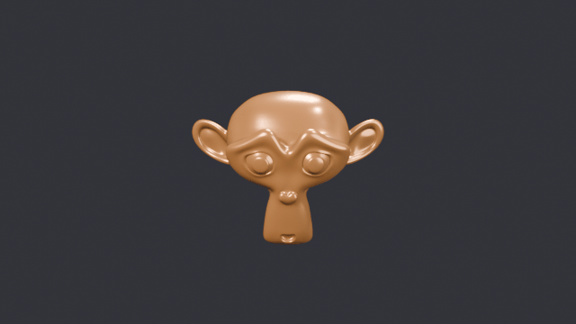

# Turntable Studio

**One click from a selected model to a ready-to-render turntable.**
Camera, three-point lighting, a seamless 360° loop and render settings, all set up around whatever you select.



## Features

- Frames your selection automatically (bounding-sphere fit, works for any aspect ratio)
- Camera orbit that loops seamlessly (linear, frame N+1 equals frame 1)
- Optional key / fill / rim area lights that orbit with the camera, so lighting stays consistent
- Solid background color, EEVEE or Cycles, resolution, samples
- MP4 or PNG sequence output (falls back to PNG if your Blender build has no FFmpeg)
- Everything lives in one collection and is removed with one click; your own objects are never touched

## Install

Requires **Blender 4.2 or newer** (tested on 5.0 and 5.2).

1. Download `turntable_studio-<version>.zip` from the [Releases](../../releases) page (or run `python build.py`).
2. In Blender: **Edit → Preferences → Get Extensions → ⌄ (top right) → Install from Disk…** and pick the zip.

## Use

1. Select the object(s) you want to show off.
2. Open the **Turntable** tab in the 3D viewport sidebar (press `N`).
3. Click **Create Turntable**, tweak anything you like, then **Render Turntable**.

Created objects live in the `Turntable Studio` collection. Edit them freely, or hit the trash button to remove the whole rig.

## Development

```
python build.py                        # build dist/*.zip
blender --background --factory-startup --python test_addon.py   # smoke test
```

## Roadmap

- [ ] Ground plane / shadow catcher
- [ ] HDRI picker
- [ ] Ping-pong and partial-arc orbits
- [ ] Multiple camera angles in one go
- [ ] Preset save/load

Ideas and PRs welcome.

## License

MIT
